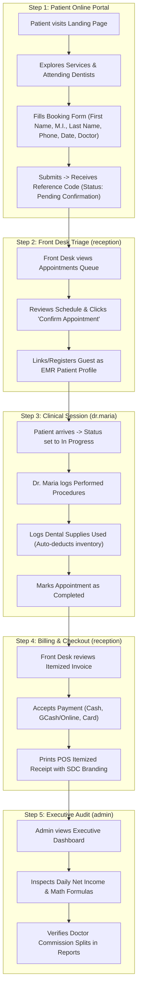

# SDC Dental Care Management System
## Complete End-to-End Patient Booking & Clinical Workflow Walkthrough Guide

This interactive step-by-step walkthrough guides you through the entire lifecycle of a patient visit in **SDC Dental Care**—from an online booking on the public landing page, to front desk triage, dentist operatory session, consumable inventory deduction, billing, receipt printing, and real-time financial KPI updates on the Admin Dashboard.

---

## 📋 Role Credentials Quick Reference

| Role | Username | Password | Primary Scope in this Workflow |
| :--- | :--- | :--- | :--- |
| **Public Patient** | *(No login required)* | — | Fills up online appointment request |
| **Front Desk** | `reception` | `password123` | Confirms booking, registers patient, collects payment, prints receipt |
| **Attending Dentist** | `dr.maria` | `password123` | Reviews EMR, logs performed treatments & dental supplies |
| **Clinic Admin** | `admin` | `password123` | Inspects real-time financial metrics & doctor commission splits |

---

## 🗺️ Visual End-to-End Workflow Map

---

## 🚀 Step-by-Step Hands-on Demonstration

Follow these 5 phases to experience the full operational system:

---

### Phase 1: The Patient Experience (Public Portal)

**Goal:** Submit an online appointment request as a new client named **Sofia D. Santos**.

1. Ensure **Apache** and **MySQL** are running in your XAMPP Control Panel.
2. Open your web browser and navigate to:
   👉 **`http://localhost/SDC-DENTAL-CLINIC/`**
3. **Experience the Landing Page Design**:
   * Observe the **Monumental Typography** and **Dental Handpiece Cutout** in the Hero.
   * Watch the rotating keyword and the dynamic **Scope of Practice Marquee ribbon**.
4. **Explore Signature Treatments**:
   * Scroll down to **Signature Treatments**.
   * Hover across the photographic slices to experience the horizontal expanding accordion.
   * Click on any treatment (e.g. *Dental Prophylaxis*) to open the **Editorial Lookbook Modal**.
   * Notice that **prices are strictly hidden from clients**, emphasizing clinical indications and step-by-step visit expectations.
5. **Explore Our Attending Dentists**:
   * Scroll to **Our Attending Dentists**.
   * Hover over the vertical strips to see the accordion expand with clinician bios.
   * Click on **Dr. Maria Santos, DMD** to open the **Clinician Credentials Modal**.
   * Click the button: **"Book With This Doctor"**.
   * *Notice:* The page smoothly scrolls down to the appointment form and automatically pre-selects Dr. Maria Santos!
6. **Fill out the Booking Form**:
   * **First Name:** `Sofia`
   * **M.I. (Optional):** `D.`
   * **Last Name:** `Santos`
   * **Contact Phone Number:** `0917 888 9911`
   * **Clinic Branch:** `SDC Dental Care - Main Branch`
   * **Preferred Date:** *(Choose tomorrow's date or any upcoming weekday)*
   * **Preferred Time:** `10:00 AM - Morning Slot`
   * **Preferred Dentist:** `Dr. Maria Santos, DMD` *(pre-selected)*
   * *(Notice: The Dental Concern textarea is cleanly removed as requested!)*
7. Click **"Submit Appointment Request"**.
8. **Confirmation Screen**:
   * You will arrive at the **Booking Submitted** screen (`views/portal/success.php`).
   * Take note of your **Booking Reference Code** (e.g., `APT-2026-0005`).

---

### Phase 2: Front Desk Triage & Patient Confirmation

**Goal:** As clinic receptionist, review the new online request, confirm the slot, and create Sofia's EMR profile.

1. In your browser, open a new tab or click **Staff Login**:
   👉 **`http://localhost/SDC-DENTAL-CLINIC/index.php?page=login`**
2. Log in with the **Front Desk** credentials:
   * **Username:** `reception`
   * **Password:** `password123`
3. Click on **Appointments** in the left sidebar (`index.php?page=appointments`).
4. **Spot the New Online Booking**:
   * Look at the top of the appointment table.
   * You will see **Sofia D. Santos** with the badge **`Pending Confirmation`** and source **`Online Portal`**.
5. Click **View Details** (the blue eye icon or view link).
6. **Perform Front Desk Actions**:
   * Review Sofia's contact phone number and preferred schedule.
   * **Confirm the Slot:** Under *Appointment Status*, change status to **Confirmed** and click **Update Status**.
   * **Optional Dentist Reassignment:** If Dr. Santos is on leave, you can test the reassignment dropdown to Dr. James Cruz. The system will prompt for an audit justification (e.g., *"Patient requested earlier morning slot"*).
   * **Register as Official EMR Patient:**
     * In the Patient Info card, click **"Register as Patient in EMR"** (or go to *Patients & EMR* -> *Register New Patient*).
     * Enter Sofia's profile details:
       * First Name: `Sofia`, Last Name: `Santos`, Phone: `0917 888 9911`
       * **Occupation:** `Creative Director` *(interview requirement)*
       * Allergies: `None` | Medical History: `No systemic conditions`
     * Click **Save Patient**. Now Sofia is officially part of the clinic EMR!

---

### Phase 3: Patient Arrives & Doctor Operatory Session

**Goal:** The patient sits on the dental chair. Dr. Maria performs the treatment, logs dental supplies, and completes the procedure.

1. **Patient Check-In:**
   * In Sofia's appointment record, update the status to **`In Progress`** (representing Sofia seated in Dental Operatory Suite 1).
2. **Log in as Attending Dentist**:
   * Log out of the reception account (bottom-left user profile icon -> Logout).
   * Log in with **Dr. Maria Santos's** credentials:
     * **Username:** `dr.maria`
     * **Password:** `password123`
3. **Dr. Maria's Clinician Dashboard**:
   * Notice Dr. Maria's personal clinician view: her monthly accumulated commission split and today's clinical queue.
4. Go to **Appointments** and open **Sofia D. Santos's** active appointment.
5. **Record Performed Clinical Treatments**:
   * Scroll to the **Treatments Performed** section.
   * Click **"Add Performed Treatment"**:
     * Select: `Comprehensive Oral Examination & Consultation` (₱500.00, 30% split)
     * Click **Add Procedure**.
   * Add a second procedure:
     * Select: `Dental Prophylaxis (Cleaning) - Mild` (₱1,200.00, 30% split)
     * Click **Add Procedure**.
   * *Notice:* The system automatically calculates Dr. Maria's earned commission (₱150 + ₱360 = **₱510.00**) and the clinic's retention (₱1,190.00) in real time!
6. **Log Consumables Used (Inventory Auto-Deduction)**:
   * Under **Dental Supplies Used**, log the materials used:
     * `Disposable Saliva Ejector Suction Tips` — Quantity: `1`
     * `Prophy Paste Mint Flavor` — Quantity: `1`
   * Click **Record Supply Usage**.
   * *Notice:* The clinic's inventory immediately decrements stock without manual spreadsheet tracking!
7. **Complete the Session**:
   * Update the appointment status to **`Completed`**.
   * Enter Doctor's Notes: *"Patient oral prophylaxis completed smoothly. Advised 6-month recall."*

---

### Phase 4: Billing, Multi-Payment & Itemized POS Receipt

**Goal:** As Front Desk, generate Sofia's invoice, accept GCash payment, and print the itemized receipt.

1. Log out of `dr.maria` and log back in as:
   * **Username:** `reception`
   * **Password:** `password123`
2. In the left navigation, click **Billing & Receipts** (`index.php?page=billing`).
3. Find **Sofia D. Santos's** invoice (marked with status **`Unpaid`** or **`Pending`**).
4. Click **View Invoice / Collect Payment**:
   * Review the itemized procedures:
     * *Oral Exam & Consultation:* ₱500.00
     * *Dental Prophylaxis (Mild):* ₱1,200.00
     * **Total Billed:** ₱1,700.00
5. Click **"Record Payment"**:
   * **Payment Method:** Choose **Online (GCash / Maya)**
   * **Amount Tendered:** `1700.00`
   * **Reference Number:** `GC-9823419082`
   * Click **Confirm Payment**.
   * The invoice status instantly transitions to **`Paid`**!
6. Click **"Print Itemized Receipt"**:
   * Preview the official receipt formatted for standard **80mm Thermal POS** printers.
   * Note the official clinic header, transaction time, itemized treatments, payment channel reference, and attending clinician license number.

---

### Phase 5: Executive Dashboard & Commission Audit

**Goal:** As Clinic Manager / Owner, verify how Sofia's payment updates financial KPIs, daily net income, and doctor commission payout.

1. Log out of `reception` and log in as the Clinic Manager:
   * **Username:** `admin`
   * **Password:** `password123`
2. **Executive Dashboard Live KPIs** (`index.php?page=dashboard`):
   * Look at the **Payment Method Breakdown (Today)**:
     * The **Online Payments** card reflects Sofia's **₱1,700.00** gross receipt and `1 txn`!
   * Look at **Daily Net Income**:
     $$\text{Daily Net Income} = \text{Collected Revenue Today} - \text{Disbursed Operating Expenses Today}$$
   * Click **"Inspect Math"** on any metric card:
     * A transparent modal opens showing the raw SQL aggregation, itemized payments, and arithmetic formulas backing the metric.
3. **Audit Doctor Commission Splits**:
   * In the left menu, click **Commission Splits** under Reports (`index.php?page=commissions`).
   * Select **Dr. Maria Santos, DMD**.
   * Verify that Sofia's appointment appears in the ledger with:
     * Procedure Subtotal: ₱1,700.00
     * Doctor Commission (30%): **₱510.00**
     * Clinic Net Share (70%): **₱1,190.00**

---

## 🎯 Verification Checklist

After running through the 5 phases, you will have validated:

- [x] **Client-Facing Aesthetics:** Modern architectural hero with dental handpiece cutouts, typography, and dynamic marquee.
- [x] **No Prices Shown to Patients:** Signature Treatments and Lookbook modal emphasize clinical care without displaying prices.
- [x] **Clean Booking Fields:** Patient name asks for `First Name`, `M.I. (Optional)`, and `Last Name` with zero `Dental Concern` textarea.
- [x] **Attending Dentists Showcase:** 3 specialists in contiguous expanding accordion strips with clinician credential modals.
- [x] **Seamless Booking Pre-fill:** Clicking *"Book With This Doctor"* automatically pre-selects the doctor in the scheduling form.
- [x] **Front Desk Triage & EMR:** Ability to confirm, reassign with audit notes, and register full EMR profiles with occupations.
- [x] **Chairside Recording:** Attending dentist logs procedures and supplies, automatically deducting inventory stock.
- [x] **POS Receipts & Multi-Payment:** Itemized invoice generation and thermal receipt printing for Cash, GCash, or Card.
- [x] **Executive Transparency:** Real-time net income calculations, math inspection breakdown, and doctor commission split ledgers.

---

*Document created for SDC Dental Care Management System.*
