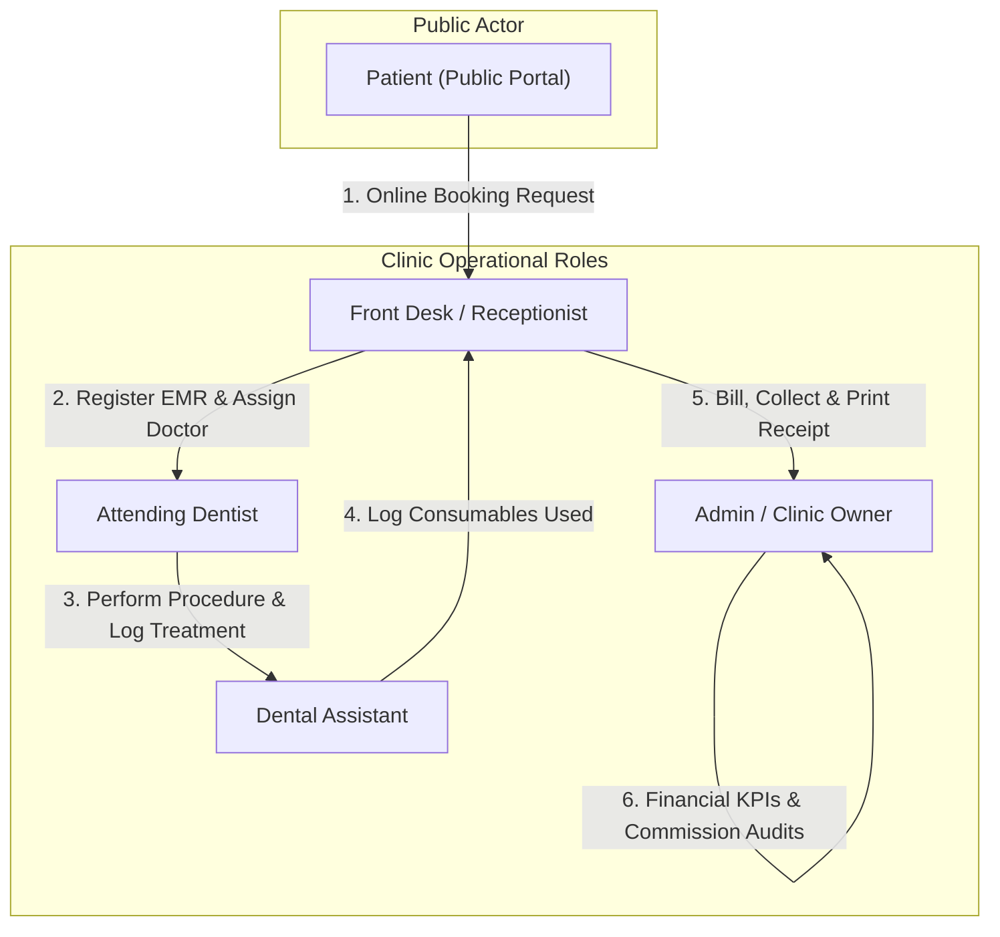
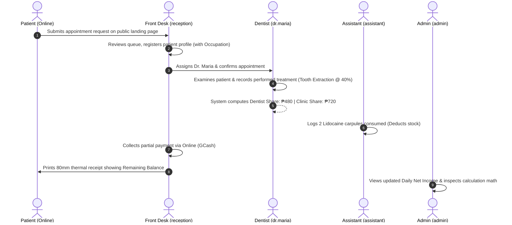

# SDC Dental Care Management System
## User Roles, Permissions & End-to-End Workflow Demonstration Guide

---

## 1. System Roles & Responsibilities Matrix

The system enforces strict Role-Based Access Control (RBAC) across four operational staff roles and one public patient portal actor:

---

### Role 1: Clinic Admin / Manager (`admin`)
* **Primary Scope**: Strategic oversight, multi-branch revenue tracking, commission split configuration, and financial audit transparency.
* **Credentials**: Username `admin` | Password `password123`
* **Key Capabilities**:
  1. **Multi-Branch Financial Dashboard**: View consolidated income or toggle between specific clinic branches.
  2. **Periodic Revenue Reports**: Filter income by **Day**, **Week**, **Month**, and **Year** with dynamic annual trend charts.
  3. **Payment Method Breakdown**: Monitor gross collections, operational disbursements, and resulting net totals for **Cash**, **Online** (GCash/Maya/Bank), and **Card**.
  4. **Daily Net Income Computation**: Review real-time net income computed as:
     $$\text{Daily Net Income} = \sum \text{Collected Payments Today} - \sum \text{Expenses Incurred Today}$$
  5. **Transparent Calculation Inspector**: Inspect the mathematical formulas, itemized gross payments, and expense deductions behind every KPI metric.
  6. **Treatment & Commission Catalog**: Configure standard fees and assign default commission split rates (**20%, 30%, 40%, or 50%**).
  7. **Doctor Payouts Ledger**: Review each dentist’s accumulated cases, billed services, and earned commission shares.

---

### Role 2: Attending Dentist (`dr.maria`, `dr.james`)
* **Primary Scope**: Clinical patient encounters, diagnosis, recording completed treatments, and personal commission tracking.
* **Credentials**: Username `dr.maria` or `dr.james` | Password `password123`
* **Key Capabilities**:
  1. **Personal Dentist Portal**: View personal earned commission totals for the current month and clinic retention splits.
  2. **Clinical Queue**: View patients assigned for the day.
  3. **Treatment Recording**: Log performed dental procedures (e.g., restorations, extractions, root canals) under appointment records.
  4. **Automatic Split Computation**: See the computed dentist payout and clinic share immediately upon recording a procedure:
     $$\text{Dentist Share} = \text{Procedure Price} \times \left(\frac{\text{Rate}}{100}\right)$$
  5. **Medical History Review**: Access patient profiles, dental history, systemic illnesses, allergies, and attached X-rays.

---

### Role 3: Front Desk / Receptionist (`reception`)
* **Primary Scope**: Patient intake, scheduling, dentist assignment & reassignment, billing, payments, and receipt printing.
* **Credentials**: Username `reception` | Password `password123`
* **Key Capabilities**:
  1. **Appointment Triage & Calendar**: Review incoming online booking requests (`Pending Confirmation`), confirm appointments, and book walk-in/phone visits.
  2. **Dentist Assignment & Reassignment**: Select the patient's preferred dentist. If that doctor is unavailable, reassign to another dentist while entering a mandatory audit justification.
  3. **Patient Registration (EMR)**: Create new patient profiles with contact numbers, medical histories, allergies, and the required **Occupation** field.
  4. **Document & X-Ray Management**: Upload panoramic, periapical, and bitewing X-rays (JPG, PNG, PDF, DICOM) to patient records.
  5. **Billing & Invoicing**: Review auto-generated invoices based on treatments performed by the dentist.
  6. **Multi-Payment Acceptance**: Collect payments via **Cash**, **Online** (with reference numbers), or **Card** (with approval numbers).
  7. **Installment & Balance Tracking**: Track outstanding balances for ongoing treatments (e.g., Orthodontic braces, Endodontics).
  8. **Printable Receipts**: Generate and print official receipts formatted for **80mm POS Thermal Printers** or **A4/A5 paper**.
  9. **Daily Expense Logging**: Record daily operational disbursements (water, electricity, lobby supplies) with attached receipts.

---

### Role 4: Dental Assistant (`assistant`)
* **Primary Scope**: Operatory assistance, consumable tracking, and dental supply inventory maintenance.
* **Credentials**: Username `assistant` | Password `password123`
* **Key Capabilities**:
  1. **Per-Patient Supply Usage Logging**: During or immediately after a procedure, record the exact consumables used for that patient (e.g., 2 carpules of Lidocaine, 1 composite syringe tip, 2 suction tips).
  2. **Automatic Stock Deduction**: Logging patient usage automatically decrements available inventory in the `supplies` table.
  3. **Dental Supply Catalog**: Monitor on-hand stock and receive low-stock alerts when items reach their reorder points.
  4. **Restocking & Stock Adjustments**: Update stock quantities upon receiving new shipments from dental suppliers.

---

### Public Actor: Patient (Online Visitor)
* **Access**: Public website (`http://localhost/SDC-DENTAL-CLINIC/`)
* **Key Capabilities**:
  1. Browse clinic services, standard fees, clinical sterilization standards, and doctor credentials.
  2. Submit an online appointment request by providing:
     * **Full Name**
     * **Contact Phone Number**
     * **Preferred Date & Time Slot**
     * **Clinic Branch**
     * **Preferred Dentist** (Optional)
     * **Chief Dental Concern**
  3. Receive an instant booking reference code with instructions that the clinic front desk will call/text to confirm.

---

## 2. End-to-End Workflow Demonstration

Here is a step-by-step walkthrough of a complete patient lifecycle, from public online booking to financial reporting.

---

### Step 1: Patient Books Online via the Public Landing Page
1. Open your browser to: **`http://localhost/SDC-DENTAL-CLINIC/`**
2. Scroll to the **"Request an Appointment Online"** form at the bottom.
3. Fill out the fields:
   * **Full Name**: `Roberto Gomez`
   * **Phone Number**: `0919 777 9999`
   * **Preferred Date**: Tomorrow's date
   * **Preferred Time**: `10:00 AM - Morning Slot`
   * **Clinic Branch**: `SDC Dental Care - Main Branch`
   * **Preferred Dentist**: `Dr. Maria Santos, DMD`
   * **Dental Concern**: `Severe toothache on upper left molar, swelling and sensitivity to cold.`
4. Click **"Submit Appointment Request"**.
5. The system generates a confirmation screen with a reference code (e.g. `APT-2026-0005`).

---

### Step 2: Front Desk Reviews & Registers Patient Profile
1. Log in at `http://localhost/SDC-DENTAL-CLINIC/index.php?page=login`:
   * **Username**: `reception`
   * **Password**: `password123`
2. Go to **Appointments** in the sidebar. You will see Roberto Gomez's appointment listed with status **`Pending Confirmation`**.
3. Click **"Manage"** on that appointment.
4. Click **"Confirm Appointment"** (status changes to `Confirmed`).
5. Under Patient Profile, click **"Register as Permanent Patient →"**:
   * First Name: `Roberto` | Last Name: `Gomez`
   * Phone: `0919 777 9999`
   * **Occupation**: Enter `Civil Engineer` *(testing the requested Occupation field)*
   * Allergies: `None reported`
   * Click **"Create Patient Record"**.
6. The patient is registered with code `PAT-2026-0004` and linked to the appointment.

---

### Step 3: Dentist Performs Procedure & Logs Treatment
1. Log in as the dentist:
   * **Username**: `dr.maria`
   * **Password**: `password123`
2. The dentist sees Roberto Gomez in the schedule. Open the appointment.
3. Click **"Mark In-Progress"** when the patient is seated in the dental chair.
4. Under **"Clinical Treatments Performed"**, click **"Add Performed Treatment"**:
   * Procedure: Select `Simple Tooth Extraction` (Standard Price: ₱1,200.00 | 40% Split)
   * Attending Dentist: `Dr. Maria Santos`
   * Actual Charged Fee: `1200.00`
   * Commission Split: `40% Dentist / 60% Clinic`
   * Clinical Notes: `Extracted tooth #26, complete and uncomplicated.`
   * Click **"Save Procedure & Compute Split"**.
5. **Instant Computation**:
   * Dentist Commission (40%): **₱480.00**
   * Clinic Retention Share (60%): **₱720.00**
6. Click **"View Math"** to inspect the formula popup verifying the arithmetic.
7. Click **"Complete Visit"**.

---

### Step 4: Assistant Logs Consumables Consumed
1. Log in as the dental assistant:
   * **Username**: `assistant`
   * **Password**: `password123`
2. Open the appointment record.
3. Scroll to **"Dental Supplies Consumed (Assistant Log)"** and click **"Log Supply Usage"**:
   * Supply Item: Select `Lidocaine HCl 2% with Epinephrine Carpules`
   * Quantity Used: `2`
   * Usage Notes: `2 carpules for local infiltration anesthesia on tooth #26`
   * Click **"Log Consumption"**.
4. Go to **Supply Tracking** in the sidebar. Notice that the Lidocaine stock has been automatically deducted by 2 units.

---

### Step 5: Front Desk Processes Payment & Prints Receipt
1. Log in back as `reception`.
2. Open Roberto Gomez’s appointment or go to **Billing & Receipts**.
3. Open Invoice `INV-2026-0003` (Total: ₱1,200.00 | Remaining Balance: ₱1,200.00).
4. Under **"Record Patient Payment"**:
   * Amount to Pay: `700.00` *(Simulating a partial payment)*
   * Payment Method: Select **`Online`**
   * Reference / Approval No.: Enter `GCASH-REF-8849201`
   * Notes: `Partial payment via GCash`
   * Click **"Accept Payment & Print Receipt"**.
5. The system immediately displays the **Official Receipt**:
   * Shows Patient Name, Occupation (`Civil Engineer`), and Attending Dentist (`Dr. Maria Santos`).
   * Shows Itemized Procedure: `Simple Tooth Extraction` — `₱1,200.00`.
   * Shows Payment: **`₱700.00 (Online - GCASH-REF-8849201)`**.
   * Shows **REMAINING BALANCE DUE: ₱500.00** prominently.
   * Click **"Print Official Receipt"** to test standard 80mm thermal or A5 printing.

---

### Step 6: Admin Audits Daily Net & Inspects Calculations
1. Log in as the manager:
   * **Username**: `admin`
   * **Password**: `password123`
2. View the **Executive Financial Dashboard**:
   * **Total Income Today**: Updated with the ₱700.00 collected payment.
   * **Payment Method Breakdown**: The **Online** card reflects `+₱700.00` gross.
   * **Daily Net Income**: Reflects Total Income minus Daily Expenses.
3. Click the **"Inspect Math"** button on the Daily Net card:
   * The calculation inspector opens, itemizing Roberto Gomez's receipt (`+₱700.00`) alongside operating expenses with exact step-by-step arithmetic.
4. Go to **Commission Splits** in the sidebar:
   * Filter by `Dr. Maria Santos`.
   * View her accumulated cases, total revenue billed, and earned commission share (₱480.00 payout).

---

## 3. Quick Reference Card

| Action | Recommended User | URL Route |
| :--- | :--- | :--- |
| **Public Landing & Online Booking** | Any Patient | `index.php?page=landing` *(or root `/`)* |
| **Front Desk Triage & Calendar** | `reception` | `index.php?page=appointments` |
| **Patient Registration (Occupation & EMR)** | `reception` | `index.php?page=patient_create` |
| **Dentist Treatment Log & Earnings** | `dr.maria` | `index.php?page=dentist_dashboard` |
| **Supply Usage Logging** | `assistant` | `index.php?page=inventory` |
| **Billing, Balances & Receipts** | `reception` / `admin` | `index.php?page=billing` |
| **Operating Expenses Entry** | `reception` / `admin` | `index.php?page=expenses` |
| **Executive Financials & Math Inspector** | `admin` | `index.php?page=dashboard` |
| **Commission Split Reports** | `admin` / `dr.maria` | `index.php?page=commissions` |

